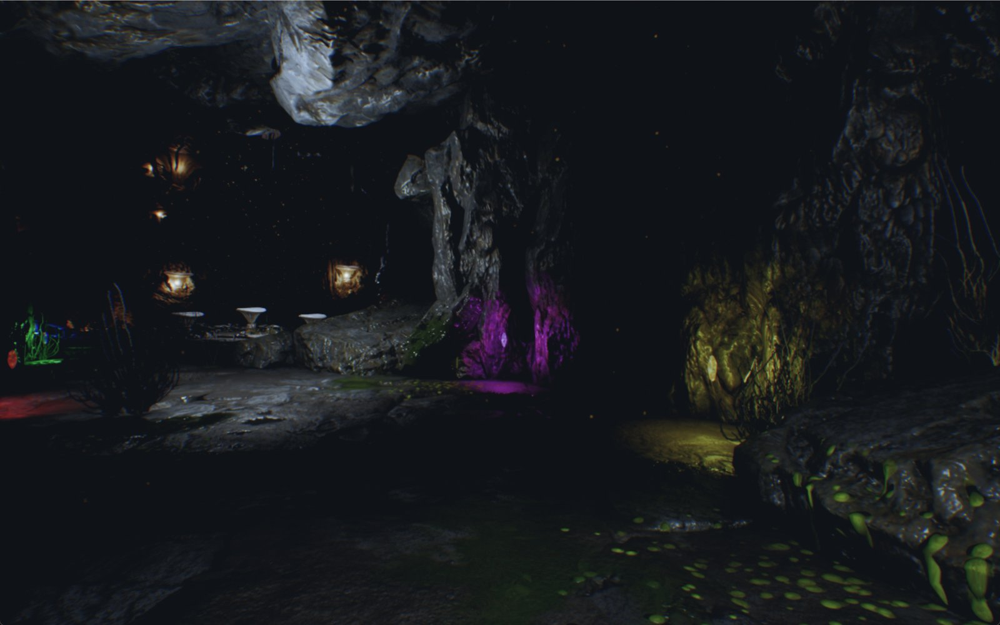
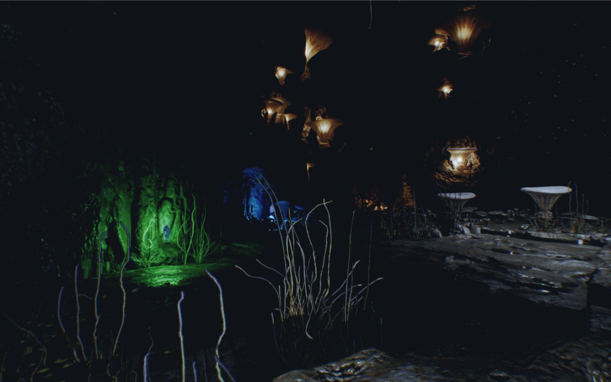
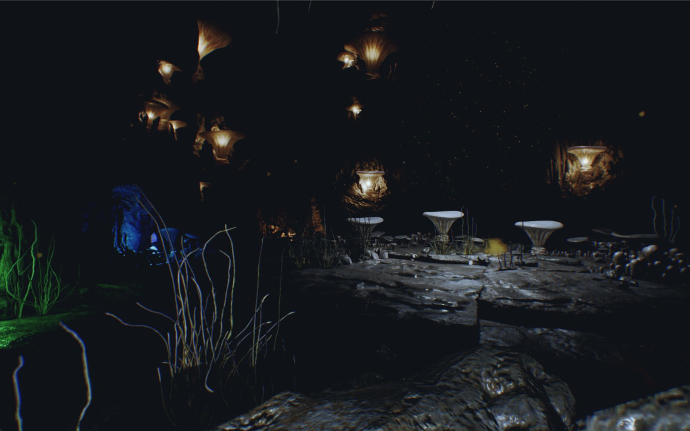

# Debugging a sabotaged Unreal Engine 5 project

Final sprint of the Unreal Engine module at Epitech Berlin (solo, May 2026).

## The brief

A client hands over an Unreal Engine 5.4 project that "several developers have
tried to fix before you". It has been deliberately broken: it does not open,
nothing spawns, the crystals look wrong and make no sound, interaction and the
puzzle do nothing, and it runs at 10-20 FPS in a nearly empty scene. The job:
get it back to the client's reference video, then add a feature of my own with
proper visual and audio feedback.

## What was broken, and why

Numbers follow the [debug journal](docs/debug-journal.md), which details the
diagnosis of each one.

| # | Symptom | Root cause | Fix |
|---|---|---|---|
| 1 | Project won't open | Trailing comma in the `.uproject` (invalid JSON) and a reference to a dead plugin | Fixed the JSON, removed the plugin |
| 3 | White outline on every crystal | `BeginPlay` overridden without calling the parent, so the outline decal is never hidden | Added the `Parent: BeginPlay` call |
| 4 | Crystals are silent | The six branches of the crystal-type `Switch` assigned an empty sound | Assigned the right cue per crystal |
| 5 | Interaction does nothing | Tick disabled on the player, so the interaction line trace never runs | Re-enabled tick, checked the trace with debug draw |
| 6 | Correct puzzle input does nothing | The completion event dispatcher was declared but never called | Called it when the combination is valid |
| 7 | Game slows down over time | Three `Event Tick → SpawnActor` (HUD widget, game mode, level) spawned about 3,600 player actors per minute | Removed the spawns |
| 8 | Door can be walked through | The door rocks were Chaos geometry collections built from a Nanite mesh with complex-as-simple collision, which never blocks the pawn | Split visuals and collision: a child static mesh with `BlockAll` on each rock, moving with the door |
| 9 | Pedestals can be grabbed | `Item` tag inherited from the parent class | Overrode the tags |
| 10 | Pedestal unusable after first removal | Reference not cleared on end overlap | Cleared it in `OnComponentEndOverlap` |

## Performance

Profiled with `stat unit` / `stat gpu` in the editor and in a packaged build:

- removed the per-tick actor spawns (the progressive slowdown),
- cleaned up `DefaultEngine.ini` and audited the lights,
- switched Virtual Shadow Maps to shadow maps and enabled Nanite,
- built lighting and capped texture groups: VRAM over-budget went from **81 GB to 448 MB**,
- editor draw thread time halved (**20.4 ms → 10.1 ms**).

## My feature: a memory puzzle behind the door

Solving the crystal puzzle opens a hidden room with a **Simon-like sequence
puzzle**: glowing mushrooms play a sequence of lights and notes, and the player
repeats it by shooting them, over three rounds of increasing length (3, 4, then
5 notes), with error feedback and replay. It reuses the visual language of the
first puzzle (coloured lights, outline decals) so it reads as an extension of
the level rather than a bolted-on extra. A pause menu and an end screen
complete the loop. Design and scope are in the
[feature journal](docs/feature-design.md).

## Play it

Download `Sprint6_Berlin-Windows.zip` from the
[latest release](https://github.com/Newen95/ue5-debugging-sprint/releases/latest),
unzip it and run `Sprint6/Berlin2025_Sprint6.exe` (Windows, DirectX 12 GPU).

The Unreal project itself is not published: it relies on third-party
Marketplace assets that cannot be redistributed. Both journals are written in
French.
